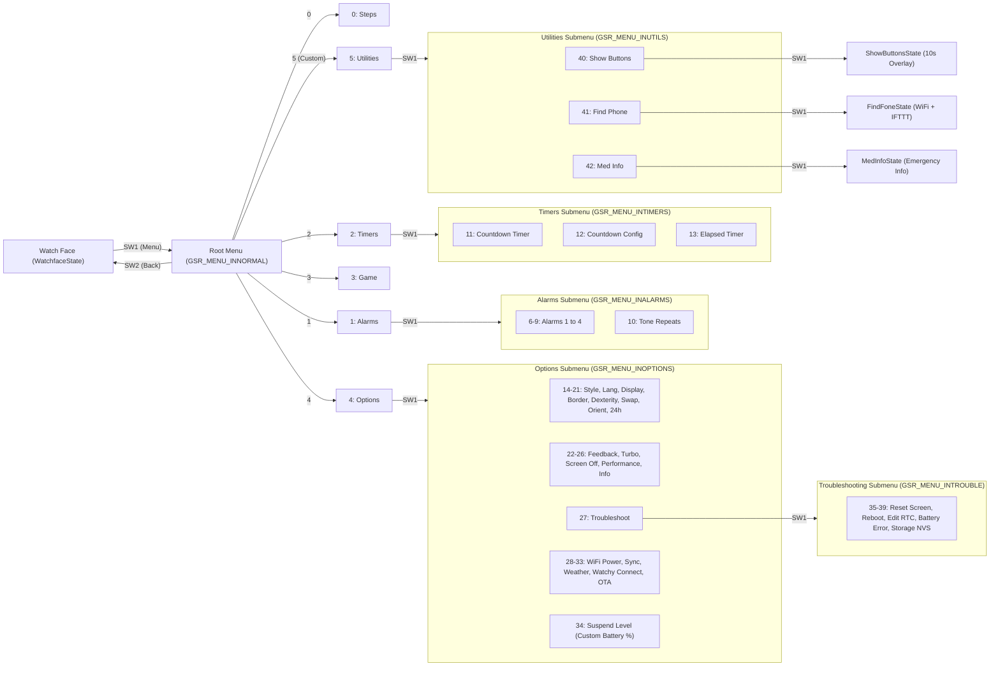
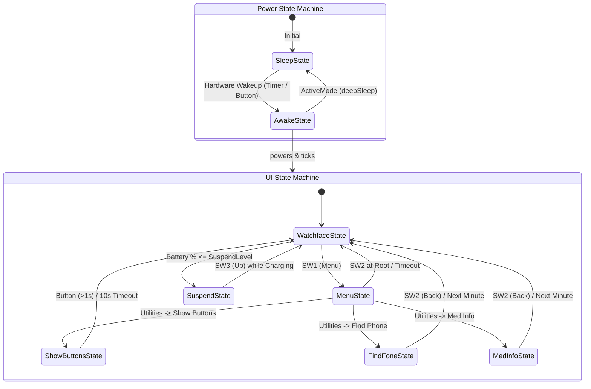

# Watchy4Granny: Assistive Smartwatch Firmware Architecture, Menu Navigation & User Guide

## 1. Executive Summary & Project Story

**Watchy4Granny** is a custom embedded firmware project for the **Watchy** open-source e-paper smartwatch (powered by the ESP32-PICO-D4 / ESP32-S3 microcontroller). Built on top of the **Watchy_GSR** (`v1.4.7N`) framework, it transforms a hobbyist smartwatch into a dedicated **assistive, safety, and cognitive-aid wearable for an elderly user ("Granny")**.

### Core Design Goals
1. **Cognitive Simplicity ("Show Buttons" Overlay)**: Elderly users can easily forget which unmarked physical button (`SW1`–`SW4`) performs which action. A dedicated on-screen legend overlays the four corners of the 200x200 e-paper display for 10 seconds to label each button dynamically.
2. **Emergency Identification ("Medical Info" Screen)**: Displays high-contrast, auto-sized emergency identification (Name, ID, Allergies, Birthdate) directly on the e-paper screen, readable even in bright sunlight.
3. **One-Action Assistance ("Find My Phone" / Panic Webhook)**: Connects to known WiFi networks and triggers an **IFTTT webhook** (`find_phone`) to ring the user's phone or notify family members, with clear visual status feedback (`FINDING PHONE`, `PHONE PINGED!`, or `WIFI FAILED!`).
4. **Battery Safety & Predictability ("Suspend State")**: E-paper screens retain their last image even without power, which can trick an elderly user into thinking a dead watch is simply "frozen" on an old time. When battery capacity drops to or below a configurable threshold (`Suspend Level`), the watch enters a dedicated `SUSPENDED` lock screen and, once plugged into a charger, displays `CHARGING...`, the exact time it was suspended, saved steps/timers, and a blinking `*` prompt next to `SW3` (`WAKE UP?`).
5. **Accidental-Press Prevention**: Rather than triggering WiFi webhooks or full-screen overlays directly from stray bumps on the main watch face, the custom assistive screens are organized cleanly inside a dedicated top-level **Utilities** submenu (`Menu -> Utilities`).

---

## 2. Hardware & Physical Button Layout

The Watchy smartwatch features a **200x200 pixel monochrome e-paper display** (`GxEPD2_154_D67`), a 3-axis accelerometer (`BMA423`), a vibration motor for haptic feedback, a real-time clock (`PCF8563` / `DS3232` / ESP32 internal RTC), and **four physical tactile buttons** on the left and right edges of the case:

| Physical Button | Physical Position | Default Logical ID | Function on Watch Face | Function Inside Menus | Function in Custom Assistive Screens |
| :--- | :--- | :--- | :--- | :--- | :--- |
| **SW1** | Bottom-Left | `1` (Menu / Enter) | Opens the Root Menu (`MenuState`) | **Selects / Enters** the highlighted submenu or confirms an edited setting | Dismisses `Show Buttons` overlay (after 1s debounce) |
| **SW2** | Top-Left | `2` (Back / Cancel) | Idle on standard watch face | **Backs out** to the parent menu, cancels an edit, or closes the Root Menu back to the Watch Face | Exits `Med Info`, cancels/exits `Find Phone`, or dismisses `Show Buttons` |
| **SW3** | Top-Right | `3` (Up / Increment) | Passed to watch face style | Scrolls **Up** (`Menu.Item - 1`) through menu items or increments a setting value | Wakes the watch from `SuspendState` while charging; dismisses `Show Buttons` |
| **SW4** | Bottom-Right | `4` (Down / Decrement) | Passed to watch face style | Scrolls **Down** (`Menu.Item + 1`) through menu items or decrements a setting value | Dismisses `Show Buttons` overlay (after 1s debounce) |

> **Accessibility & Handedness Note**: Watchy_GSR supports left-handed mode (`Dexterity: Left-handed`) and vertical button swapping (`Menu & Back: Swapped`). The firmware resolves physical buttons to logical functions via `WatchyGSR::getSWValue(SW1, SW2, SW3, SW4)` so the `Show Buttons` overlay always labels the physical corners accurately.

---

## 3. Complete Menu Navigation Hierarchy (Mindmap & Taxonomy)

All menus in Watchy4Granny use circular "roller" navigation (`roller(val, min, max)`): scrolling past the last item wraps around to the first item, and scrolling up past the first item wraps to the last.

### 3.1 Hierarchical Menu Tree (Structured for Mindmap Generation)

* **Watch Face (`WatchfaceState`)**
  * **Root Menu (`GSR_MENU_INNORMAL`, opened with `SW1`)**
    * **0. Steps (`GSR_MENU_STEPS`)**
      * View current & yesterday's step counts
      * `Tomorrow` — Configure daily step-counter reset hour and minute
      * `Reset Today` — Zero out today's step count
    * **1. Alarms (`GSR_MENU_ALARMS` -> enters `GSR_MENU_INALARMS`)**
      * **6. Alarm 1 (`GSR_MENU_ALARM1`)** — Set Hour/Minutes, Tone Repeats, Day-of-Week mask, Repeat mode, and Active toggle
      * **7. Alarm 2 (`GSR_MENU_ALARM2`)** — Set Hour/Minutes, Tone Repeats, Day-of-Week mask, Repeat mode, and Active toggle
      * **8. Alarm 3 (`GSR_MENU_ALARM3`)** — Set Hour/Minutes, Tone Repeats, Day-of-Week mask, Repeat mode, and Active toggle
      * **9. Alarm 4 (`GSR_MENU_ALARM4`)** — Set Hour/Minutes, Tone Repeats, Day-of-Week mask, Repeat mode, and Active toggle
      * **10. Tone Repeats (`GSR_MENU_TONES`)** — Master alarm tone repeat percentage (`100%` down to `20%`)
    * **2. Timers (`GSR_MENU_TIMERS` -> enters `GSR_MENU_INTIMERS`)**
      * **11. Countdown Timer (`GSR_MENU_TIMEDN`)** — Set Hours/Minutes/Seconds, Max Tones, Repeat flag, and Start/Stop countdown
      * **12. Countdown Config (`GSR_MENU_TMEDCF`)** — Countdown timer behavior configuration
      * **13. Elapsed Timer (`GSR_MENU_TIMEUP`)** — Stopwatch start/stop and elapsed time display
    * **3. Game (`GSR_MENU_GAME`)** *(Visible only when a game add-on is registered)*
      * Launches the active watch game (`GSR_GAMEON`)
    * **4. Options (`GSR_MENU_OPTIONS` -> enters `GSR_MENU_INOPTIONS`)**
      * **14. Watch Style (`GSR_MENU_STYL`)** — Switch between Classic GSR and installed watch faces
      * **15. Language (`GSR_MENU_LANG`)** — UI language selection
      * **16. Display Style (`GSR_MENU_DISP`)** — `Light` (white background) or `Dark` (black background)
      * **17. Border Mode (`GSR_MENU_BRDR`)** — E-paper border polarity
      * **18. Dexterity (`GSR_MENU_SIDE`)** — `Right-handed` or `Left-handed` button orientation
      * **19. Menu & Back (`GSR_MENU_SWAP`)** — `Normal` or `Swapped` vertical button arrangement
      * **20. Orientation (`GSR_MENU_ORNT`)** — `Watchy UP` (accelerometer check) or `Ignore`
      * **21. Time Mode (`GSR_MENU_MODE`)** — `24 Hour` or `AM/PM`
      * **22. Feedback (`GSR_MENU_FEED`)** — Haptic vibration motor `On` / `Off`
      * **23. Turbo Time (`GSR_MENU_TRBO`)** — Keep CPU/display responsive for `0`–`10` seconds after button press
      * **24. Screen Off (`GSR_MENU_DARK`)** — Configure Screen Blanking, Auto-Off timeout (`1`–`10` mins), Sleeping Begins hour, Sleeping Ends hour, and Bedtime Orientation
      * **25. Performance (`GSR_MENU_SAVE`)** — `Turbo`, `Normal`, or `Battery Saving`
      * **26. Information (`GSR_MENU_INFO`)** — Firmware build version (`1.4.7N`) and live battery voltage
      * **27. Troubleshoot (`GSR_MENU_TRBL` -> enters `GSR_MENU_INTROUBLE`)**
        * **35. Reset Screen (`GSR_MENU_SCRN`)** — Force full e-paper refresh to clear ghosting
        * **36. Watchy Reboot (`GSR_MENU_RSET`)** — Save step counts & settings to NVS and restart ESP32
        * **37. Edit RTC / Drift (`GSR_MENU_TOFF`)** — Manual time adjustment and crystal drift calibration
        * **38. Battery Low Error (`GSR_MENU_BERR`)** — Fine-tune low-battery voltage offset (`0.00V`–`0.10V`)
        * **39. Storage Settings (`GSR_MENU_UNVS`)** — Enable, disable, or wipe Non-Volatile Storage (NVS)
      * **28. WiFi Tx Power (`GSR_MENU_TPWR`)** — Radio transmit power (`2dBm [Low]` up to `19.5dBm [Max]`)
      * **29. Sync Watchy (`GSR_MENU_SYNC`)** — Trigger immediate NTP time & timezone sync or configure daily auto-sync
      * **30. Weather (`GSR_MENU_WEAT`)** — Open-Meteo update interval & temperature scale
      * **31. Watchy Connect (`GSR_MENU_WIFI`)** — Starts SoftAP captive portal (`SSID: "Watchy Connect"`, IP `192.168.4.1`) to configure up to 10 WiFi APs, custom NTP server, weather coordinates, and bulk settings string
      * **32. OTA Update (`GSR_MENU_OTAU`)** — Over-The-Air firmware upload via ArduinoOTA
      * **33. OTA Website (`GSR_MENU_OTAM`)** — Starts local HTTP configuration server on the connected WiFi network
      * **34. Suspend Level (`GSR_MENU_SUSP`)** *(Custom Watchy4Granny Option)* — Sets battery percentage threshold (`At: X%`) at which the watch enters `SuspendState`
    * **5. Utilities (`GSR_MENU_UTILS` -> enters `GSR_MENU_INUTILS`)** *(Custom Watchy4Granny Assistive Menu)*
      * **40. Show Buttons (`GSR_MENU_UTILS_BTN`)** — Launches `ShowButtonsState` (10-second corner button legend)
      * **41. Find Phone (`GSR_MENU_UTILS_FIND`)** — Launches `FindFoneState` (connects to WiFi and triggers IFTTT webhook)
      * **42. Med Info (`GSR_MENU_UTILS_MED`)** — Launches `MedInfoState` (displays emergency medical identification)

### 3.2 Visual Menu Navigation Flowchart

---

## 4. Dual State Machine Architecture

Instead of relying on a monolithic procedural loop, Watchy4Granny introduces two orthogonal, cooperating state machines in `src/GSR.cpp`, built on the generic `State` and `StateMachine` base classes in `src/StateMachine.h`:

1. **`PowerStateMachine` (`src/PowerStateMachine.{h,cpp}`)**:
   * Controls the ESP32 power lifecycle between `SleepState` and `AwakeState`.
   * On hardware wakeup (RTC minute timer `ESP_SLEEP_WAKEUP_EXT0` or button/accelerometer interrupt `ESP_SLEEP_WAKEUP_EXT1`), `setup()` calls `watchy.init()` and `powerSM.handleWakeup()`, transitioning into `AwakeState`.
   * While in `AwakeState`, `execute()` calls `watchy->tick()` to service timekeeping, alarms, WiFi state machines, and screen updates.
   * When `ActiveMode` becomes `false` (no active menus, overlays, WiFi requests, or turbo timers), `powerSM.shouldSleep()` returns `true` and transitions to `SleepState`, invoking `watchy->deepSleep()`.

2. **`UiStateMachine` (`src/UiStateMachine.{h,cpp}`)**:
   * Runs inside `loop()` while the watch is awake, dispatching button presses (with a 50ms haptic pulse) to the active UI state:
   * **`WatchfaceState`**: Default clock screen. Renders the graphical battery icon (`drawChargeMe`), time, day, date, and status icons. Pressing `SW1` opens the native menu and transitions to `MenuState`.
   * **`MenuState`**: Delegates button navigation to `WatchyGSR::handleMenuButton()`. Automatically returns to `WatchfaceState` when `watchy->NoMenu()` becomes `true`. Selecting an item inside `Menu -> Utilities` transitions directly into one of the custom states below.
   * **`ShowButtonsState`**: Sets `showingButtons = true` and records `showButtonsStartTime = millis()`. Keeps the display awake for 10 seconds (resetting the timer if a button is held down), ignores presses during the first 1,000ms to prevent button bounce from menu selection, and returns to `WatchfaceState` on any subsequent button press or after 10 seconds.
   * **`FindFoneState`**: Sets `callingForHelp = true` and requests WiFi via `watchy->AskForWiFi()`. Once connected, `OverrideGSR::InsertWiFi()` performs an HTTPS `GET` request to the IFTTT Maker webhook (`find_phone`), sets `helpRequested = true` (`PHONE PINGED!`), and releases WiFi. If WiFi fails, `OverrideGSR::InsertWiFiEnding()` sets `wifiFailed = true` (`WIFI FAILED!`). Pressing `SW2` (Back) cancels and returns to `WatchfaceState`.
   * **`MedInfoState`**: Sets `showingMedInfo = true`, keeps the display awake, and renders centered `MEDICAL INFO` with auto-scaled typography (`aAntiCorona11pt7b` or `10pt7b` if the name exceeds 180px width). Pressing `SW2` returns to `WatchfaceState`.
   * **`SuspendState`**: Triggered in `OverrideGSR::InsertOnMinute()` when calculated battery percentage (`3.30V` = 0%, `4.20V` = 100%) is `<= GetSuspendLevel()` and not charging (`GetBatteryState() != 3`). Blocks all normal button presses. When plugged into USB power (`GetBatteryState() == 3`), keeps the watch awake to display charging progress, suspension timestamp, step count, timer state, and a blinking `*` prompt near `SW3` so pressing `SW3` wakes the watch back to `WatchfaceState`.

---

## 5. Memory Persistence & Settings Storage (RTC RAM vs. NVS Flash)

Because the ESP32 enters deep sleep after every minute tick or UI interaction, standard C++ global variables in SRAM are lost whenever the processor sleeps. Watchy4Granny uses a two-tier persistence model:

### Tier 1: Deep-Sleep Persistence (`RTC_DATA_ATTR` in RTC Slow Memory)
Variables annotated with `RTC_DATA_ATTR` reside in the ESP32's 8 KB RTC Slow Memory, which stays powered during deep sleep:
* Custom UI flags in `src/OverrideGSR.{h,cpp}`: `callingForHelp`, `helpRequested`, `wifiFailed`, `showingMedInfo`, `isSuspended`, `showingButtons`, and `suspendTime`.
* Core framework structures in `src/Watchy_GSR.cpp`: `GSRWiFi` (active WiFi credentials in RAM), `Options`, `NTPData`, `WeatherData`, `WatchTime`, `Steps`, `TimerDown`, `Alarms_*`, and `LastBuild`.
* **Build-Reset Protection**: On a soft reset where `LastBuild` differs from `Build`, `WatchyGSR::init()` backs up `GSRWiFi` before calling `initZeros()` and restores it immediately so in-memory WiFi credentials are preserved.

### Tier 2: Non-Volatile Storage (`nvs` Flash Partition at `0x9000`)
A hardware reset (such as toggling the `EN` pin over USB serial) clears RTC memory. To survive hardware resets and power loss, user settings are persisted to the **ESP32 NVS flash partition** (`offset = 0x9000`, `size = 0x5000` / 20 KB) under the `"storage"` namespace:
* **`GSR-Options`**: A versioned (Version `140`) binary structure encoded in Base64 by `WatchyGSR::GetSettings()` and decoded by `WatchyGSR::StoreSettings()`. It stores:
  * Up to 10 WiFi Access Points (SSID, Password, and per-AP TX power index)
  * Custom NTP server hostname (`NTPData.fromWeb`, defaulting to `pool.ntp.org`) and sync schedule
  * Static weather latitude, longitude, update interval, and metric/imperial unit flag
  * All user display and button preferences (24-hour mode, Light/Dark mode, Lefty, Swapped, Orientation, Sleep style/hours, Turbo duration)
  * All 4 alarm configurations and countdown timer defaults
  * External and internal RTC drift calibration values
* **`GSR-TZ`**: The POSIX timezone rule string (e.g., `EET-2EEST,M3.5.0/3,M10.5.0/4`).
* **`Steps` & `YSteps`**: Cached step counts saved prior to reboots.

---

## 6. Containerized Build & NVS Backup Workflow

Watchy4Granny uses a reproducible **Podman containerized build pipeline** based on `docker.io/espressif/idf:latest` alongside a Python NVS inspection tool:

1. **NVS Settings Backup & Decode (`.agents/skills/watchy-firmware/scripts/nvs_tool.py`)**:
   * Connects to `/dev/ttyUSB0`, dumps the raw 20 KB NVS partition (`0x9000`–`0xdfFF`) to `backups/nvs_backup.bin`, and parses both the ESP32 NVS page structure and the Base64 `GSR-Options` payload into human-readable JSON (`backups/watchy_settings.json`).
   * Can restore `backups/nvs_backup.bin` back to `0x9000` at any time.
2. **Podman Containerized PlatformIO Runner (`scripts/podman_pio.sh` & `Containerfile`)**:
   * Runs PlatformIO inside `docker.io/espressif/idf:latest` with rootless `--userns=keep-id` user mapping, mounts `~/.platformio` to reuse toolchains (`framework-arduinoespressif32 @ 3.20011.230801`, `toolchain-xtensa-esp32`), and forwards `/dev/ttyUSB0` for one-command compiling and flashing.
