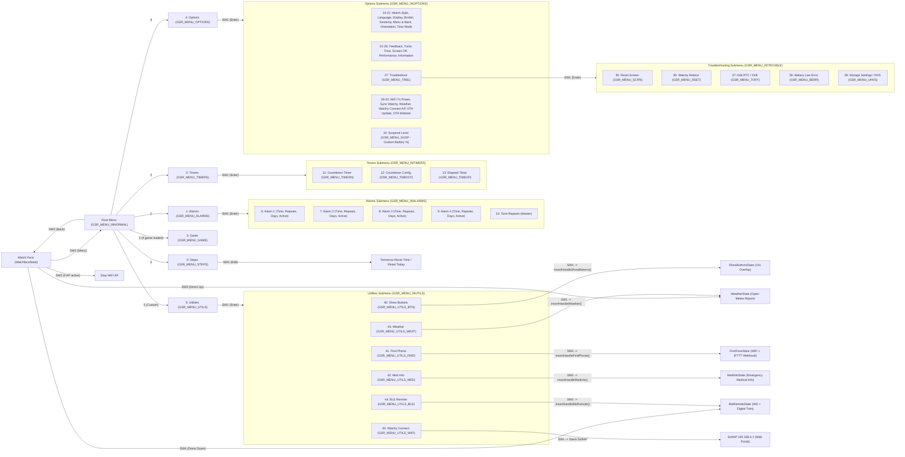
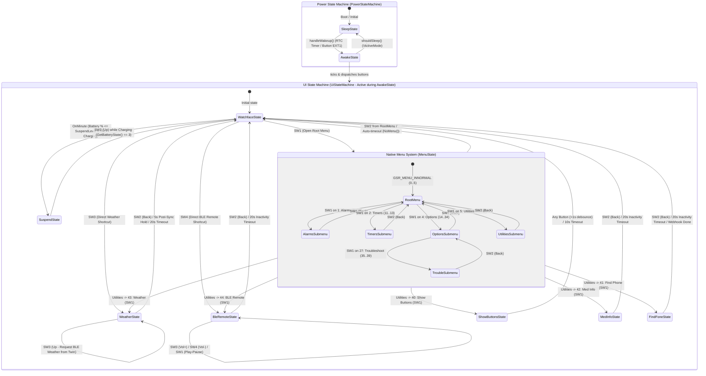

# Watchy4Granny State Machines & Menu Navigation

This document outlines the state machines and complete menu navigation hierarchy controlling the Watchy4Granny device.

## 1. Complete Menu Navigation Mindmap

## 2. Power & UI State Machine Diagram

### PowerStateMachine Summary
* **SleepState**: Puts the ESP32 into deep sleep to conserve battery.
* **AwakeState**: Powers on the display, reads sensors, runs `watchy->tick()`, and processes UI inputs. Automatically transitions to sleep when `ActiveMode` goes false.

### UiStateMachine Summary
* **WatchfaceState**: Default idle mode showing the time, date, step count, lower-left Bluetooth badge (`[ᛒ ✓]` / `[ᛒ ×]`), and lower-right battery/charging indicator (horizontally aligned at baseline `y = 195`).
  * **Minute Rollover & Refresh Guarantee**: Tracks `lastDrawnMinute` in `RTC_DATA_ATTR`.
    * When awake (e.g. BLE connected, charging, or turbo), `WatchfaceState::execute()` actively calls `watchy->syncMinuteRollover()`, which reads the RTC via `ClockSeconds()` and performs a single full refresh the exact moment the minute increments.
    * When waking from deep sleep on hardware RTC minute alarms (`ESP_SLEEP_WAKEUP_EXT0`) or dual timer backup (`ESP_SLEEP_WAKEUP_TIMER`), `setup()` detects `WatchTime.Local.Minute != lastDrawnMinute`, triggering `InsertOnMinute()` and executing a single-pass full refresh (`Updates.Full = true`). Duplicate redraw flags are cleared, and the watch returns to deep sleep in ~2 seconds.
    * In `deepSleep()`, explicit RTC pad configuration (`rtc_gpio_init`, `rtc_gpio_pullup_en`) on GPIO 27 ensures reliable `EXT0` detection alongside a dual hardware timer wakeup calibrated to 500 ms past rollover.
  * **Daily BLE Auto-Sync**: At scheduled sync time (`NTPData.SyncHour:SyncMins`), intercepts WiFi NTP and starts a 45-second BLE advertising window for the companion phone app to push fresh time and weather data.
* **MenuState**: Native `WatchyGSR` menu system (`Steps`, `Alarms`, `Timers`, `Game`, `Options`, and custom `Utilities` at the root level).
* **ShowButtonsState**: Triggered via `Menu -> Utilities -> Show Buttons`. Displays an overlay mapping `SW1`–`SW4` physical buttons to their logical functions. Ignores button inputs for the first 1 second to prevent bouncing from menu selection, then dismisses on any button press or a 10s timeout.
* **MedInfoState**: Triggered via `Menu -> Utilities -> Med Info`. Displays emergency medical info (Name, ID, Allergies, Birthdate). Exits on `SW2` or 20s inactivity timeout.
* **WeatherState**: Triggered via `SW3` direct shortcut or `Menu -> Utilities -> Weather`. Displays the full-screen weather report:
  * Condition icon + current temperature + feels-like in small font: e.g. `[icon] 3°C (-2°C)`.
  * Coordinates: `Lat/Lng: XX.X / YY.Y` (1 decimal digit).
  * Local ground elevation: e.g. `Elevation: 113 m`.
  * Relative humidity, wind speed (m/s), and barometric pressure.
  * Initiates BLE weather sync with the Digital Twin; manual refresh with `SW3`; exits on `SW2` or 20s timeout.
* **BleRemoteState**: Triggered via `SW4` direct shortcut or `Menu -> Utilities -> BLE Remote`. Starts `NimBLE` server (`Watchy4Granny`) exposing both:
  1. **BLE HID Consumer Control**: `Volume Up` (`SW3`), `Volume Down` (`SW4`), `Play/Pause` (`SW1`).
  2. **BLE Digital Twin GATT Service (`19b10000-e8f2-537e-4f6c-d104768a1214`)**: For time/timezone synchronization, weather coordinate configuration, weather payload ingestion, and battery/screen status.
  3. Exits on `SW2` or 20s timeout, shutting off BLE advertising immediately or entering deep sleep.
* **FindFoneState**: Triggered via `Menu -> Utilities -> Find Phone`. Connects to WiFi and triggers an IFTTT webhook to ring the phone.
* **SuspendState**: A low-power lock screen triggered when the battery drops to/below the configured suspend threshold (`Options -> Suspend Level`). Can be awakened via `SW3` while charging.
