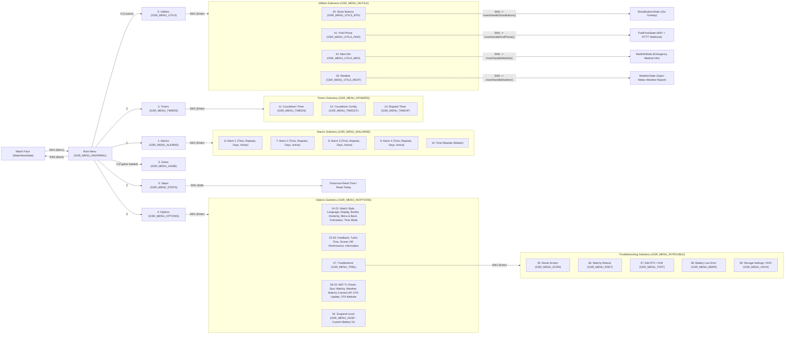
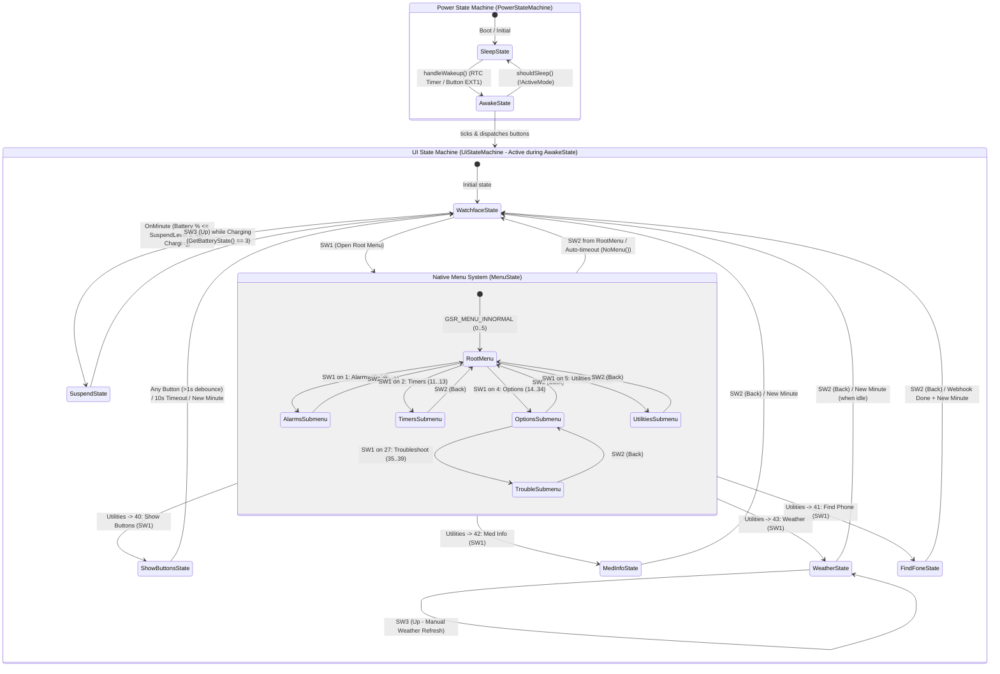

# Watchy4Granny State Machines & Menu Navigation

This document outlines the state machines and complete menu navigation hierarchy controlling the Watchy4Granny device.

## 1. Complete Menu Navigation Mindmap

## 2. Power & UI State Machine Diagram

### PowerStateMachine Summary
* **SleepState**: Puts the ESP32 into deep sleep to conserve battery.
* **AwakeState**: Powers on the display, reads sensors, runs `watchy->tick()`, and processes UI inputs. Automatically transitions to sleep when `ActiveMode` goes false.

### UiStateMachine Summary
* **WatchfaceState**: Default idle mode showing the time, battery icon, and step count.
* **MenuState**: Native `WatchyGSR` menu system (`Steps`, `Alarms`, `Timers`, `Game`, `Options`, and custom `Utilities` at the root level).
* **ShowButtonsState**: Triggered via `Menu -> Utilities -> Show Buttons`. Displays an overlay mapping `SW1`–`SW4` physical buttons to their logical functions. Ignores button inputs for the first 1 second to prevent bouncing from menu selection, then dismisses on any button press or a 10s timeout.
* **MedInfoState**: Triggered via `Menu -> Utilities -> Med Info`. Displays emergency medical info.
* **WeatherState**: Triggered via `Menu -> Utilities -> Weather`. Displays a full-screen weather report (icon, temperature, sky condition, feels-like, humidity, wind, and pressure) fetched from Open-Meteo, automatically requesting an update if stale and allowing manual refresh via `SW3`.
* **FindFoneState**: Triggered via `Menu -> Utilities -> Find Phone`. Connects to WiFi and pings the user's phone via IFTTT.
* **SuspendState**: A low-power lock screen triggered when the battery drops to/below the configured suspend threshold (`Options -> Suspend Level`). Can be awakened via `SW3` while charging.
