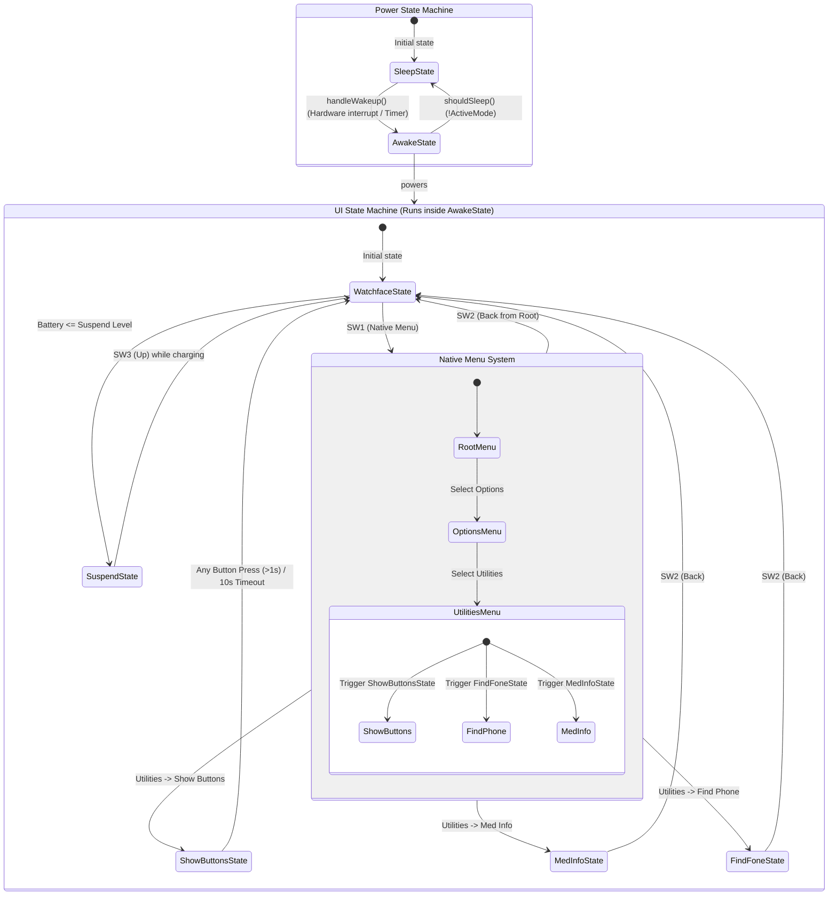

# Watchy4Granny State Machines

This document outlines the state machines controlling the Watchy4Granny device. You can visualize this directly in VSCode by opening the **Markdown Preview** (requires a Markdown Mermaid extension or native support).

## State Diagram

### PowerStateMachine Summary
* **SleepState**: Puts the ESP32 into deep sleep to conserve battery.
* **AwakeState**: Powers on the display, reads sensors, runs `watchy->tick()`, and processes UI inputs. Automatically transitions to sleep when `ActiveMode` goes false.

### UiStateMachine Summary
* **WatchfaceState**: Default idle mode showing the time, battery, and step count.
* **MenuState**: Native `WatchyGSR` menu system. Now includes a **Utilities** sub-menu under **Options**.
* **ShowButtonsState**: Triggered via `Menu -> Options -> Utilities`. Displays an overlay mapping SW1-SW4 physical buttons to their native logical functions. Ignores button inputs for the first 1 second to prevent "bouncing" from the menu selection, then dismisses on any button press or a 10s timeout.
* **MedInfoState**: Triggered via `Menu -> Options -> Utilities`. Displays emergency medical info.
* **FindFoneState**: Triggered via `Menu -> Options -> Utilities`. Connects to WiFi and pings the user's phone via IFTTT.
* **SuspendState**: A low-power lock screen triggered when the battery hits critical levels. Forces the UI to sleep to prevent accidental usage.
